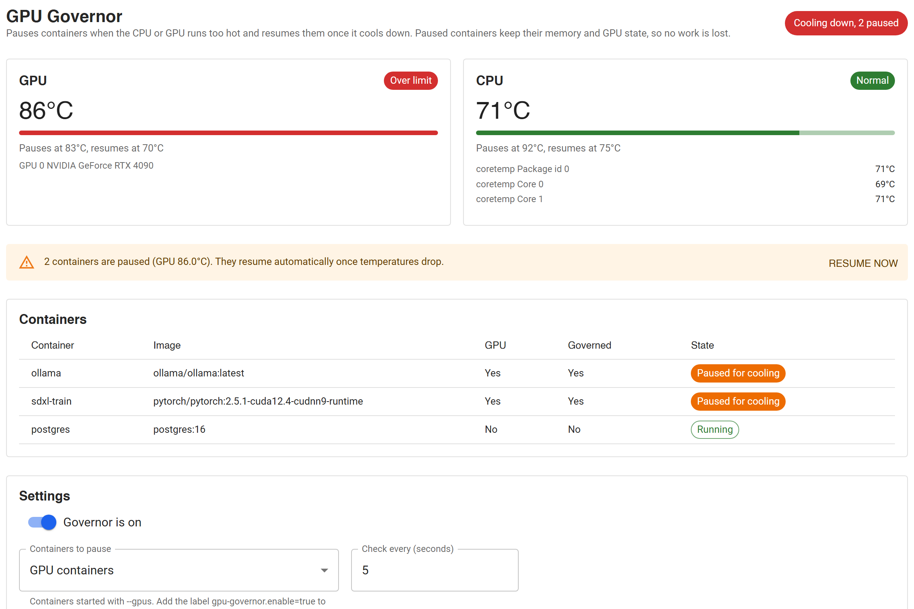

# GPU Governor

A Docker Desktop extension that watches GPU and CPU temperatures and pauses
containers when the hardware gets too hot. Once the temperature drops back
into a safe range, it resumes them. The containers are frozen, not stopped,
so a training run, render or batch job continues from exactly where it was.



## How it works

Every few seconds the backend reads:

- **GPU**: NVIDIA temperatures from `nvidia-smi`. Docker Desktop's VM has no
  NVIDIA tools, so the backend starts a small helper container
  (`gpu-governor-probe`) with GPU access and runs `nvidia-smi` inside it.
- **CPU**: package and core temperatures from `/sys/class/hwmon` (`coretemp`,
  `k10temp`, `zenpower`, `cpu_thermal`), falling back to
  `/sys/class/thermal`.

Each sensor has two limits:

| Setting | Default GPU | Default CPU | Meaning |
| --- | --- | --- | --- |
| Pause at | 83 °C | 92 °C | Readings at or above this count as hot |
| Resume at | 70 °C | 75 °C | Readings at or below this count as cool |
| Hot readings before pausing | 3 | 3 | Consecutive hot readings needed to pause |
| Cool readings before resuming | 6 | 6 | Consecutive cool readings needed to resume |

The gap between the two limits stops containers from flipping between paused
and running when the temperature sits near one value. Requiring several
readings in a row ignores short spikes.

When either sensor trips, the governor runs `docker pause` on every target
container. Once **both** sensors are back under their resume limit, it runs
`docker unpause` on the containers it paused, and only on those.

### Why no data is lost

`docker pause` uses the Linux cgroup freezer. The processes stop being
scheduled but stay in memory with all their state: RAM, open files, sockets,
and CUDA contexts with their GPU memory. On unpause they carry on from the
same instruction. Nothing is restarted or checkpointed to disk.

Things to keep in mind:

- GPU memory stays allocated while a container is paused. Paused jobs stop
  drawing compute power, which is what lets the card cool down.
- Network peers do not know the container is paused. A long pause can make
  remote clients time out, the same as with a manual `docker pause`.

### Which containers get paused

| Mode | Targets |
| --- | --- |
| GPU containers (default) | Containers started with `--gpus`, a `deploy.resources` GPU reservation, or the `nvidia` runtime |
| Labeled containers | Only containers with `gpu-governor.enable=true` |
| All containers | Every running container |

Labels work in every mode:

```sh
docker run --label gpu-governor.enable=true ...   # always governed
docker run --label gpu-governor.exclude=true ...  # never governed
```

The governor never pauses itself, its probe, or other Docker Desktop
extensions.

### Safety rules

- Containers you paused yourself are never resumed by the governor.
- If you unpause a container by hand while it is hot, the governor leaves it
  running until temperatures recover instead of fighting you.
- **Resume now** in the dashboard does the same for everything at once.
- Turning the governor off, removing the extension, or stopping the backend
  resumes everything it paused.
- The list of paused containers is saved to a volume. If the backend restarts
  while containers are paused, it picks them up again and resumes them once
  temperatures recover.
- If a sensor stops answering while it is tripped, its limit is released
  after 12 failed readings so containers cannot stay frozen forever.

## Install

### From the Extensions Marketplace

Open Docker Desktop, go to **Extensions**, search for **GPU Governor** and
click **Install**.

### From Docker Hub

```sh
docker extension install hasisyed/gpu-governor:0.1.0
```

Docker Desktop only accepts extensions that are not yet in the Marketplace if
**Settings > Extensions > Allow only extensions distributed through the
Docker Marketplace** is turned off.

### Requirements

- A Docker Desktop release whose Extensions API is 0.3.4 or newer
  (`docker extension version` shows it).
- GPU monitoring: an NVIDIA GPU with Docker Desktop on Windows (WSL 2
  backend), or Docker on Linux with the
  [NVIDIA Container Toolkit](https://docs.nvidia.com/datacenter/cloud-native/container-toolkit/latest/install-guide.html).
  Check with `docker run --rm --gpus all debian:bookworm-slim nvidia-smi`.
- CPU monitoring: Docker Desktop runs containers in a VM that usually hides
  the host's temperature sensors, so the CPU card shows "No sensor" there. On
  a Linux host, use the standalone mode below to get CPU temperatures.

## Standalone mode (Linux servers and workstations)

The same image runs without Docker Desktop and serves the HTTP API on port
9090:

```sh
docker compose -f compose.standalone.yaml up -d
curl localhost:9090/status
```

The compose file reserves the GPU so `nvidia-smi` is available directly. On a
machine without an NVIDIA GPU, remove the `deploy` section; the governor then
works on CPU temperature alone.

Flags and environment variables for `gpu-governor serve`:

| Flag | Environment | Default | |
| --- | --- | --- | --- |
| `-listen` | `GOVERNOR_LISTEN` | `:9090` | TCP address for the API |
| `-socket` | `GOVERNOR_SOCKET` | | Unix socket for the API (used by Docker Desktop) |
| `-docker-socket` | `DOCKER_SOCKET` | `/var/run/docker.sock` | Docker daemon socket |
| `-state` | `GOVERNOR_STATE` | `/var/lib/gpu-governor/state.json` | Saved settings and paused containers |
| `-sys` | `GOVERNOR_SYS` | `/sys` | sysfs root for CPU sensors |
| `-gpu` | `GOVERNOR_GPU` | `auto` | `auto`, `local` (nvidia-smi in this container), `probe` (helper container) or `off` |
| `-image` | `GOVERNOR_IMAGE` | own image | Image used for the probe container |

## API

| Method | Path | |
| --- | --- | --- |
| GET | `/status` | Readings, containers, paused list, activity log and settings |
| GET | `/config` | Current settings |
| POST | `/config` | Replace settings with the full JSON object returned by `GET /config` |
| POST | `/resume` | Resume everything the governor paused |
| GET | `/healthz` | Liveness check |

```sh
curl -X POST localhost:9090/config -d '{
  "enabled": true, "mode": "gpu", "intervalSeconds": 5,
  "gpu": {"enabled": true, "pauseAtC": 80, "resumeAtC": 68, "tripSamples": 3, "clearSamples": 6},
  "cpu": {"enabled": true, "pauseAtC": 92, "resumeAtC": 75, "tripSamples": 3, "clearSamples": 6}
}'
```

## Development

```
cmd/gpu-governor     entrypoint
internal/sensor      CPU (sysfs) and GPU (nvidia-smi) readers
internal/docker      Docker Engine API client over the unix socket
internal/probe       GPU helper container
internal/governor    limits, target selection, pause/resume loop, saved state
internal/api         HTTP API
ui/                  React dashboard shown in Docker Desktop
```

The backend uses only the Go standard library.

```sh
sh scripts/gotest.sh   # gofmt, go vet and go test inside a golang container
make build             # build the extension image for this machine
make install           # build and install into Docker Desktop
make update            # rebuild and update the installed extension
make dev-ui            # hot reload the UI inside Docker Desktop
```

## Releasing

Images are published to Docker Hub by `.github/workflows/release.yml` when a
version tag is pushed. It builds `linux/amd64` and `linux/arm64`, which the
Marketplace requires.

1. In the GitHub repository settings, add the secrets `DOCKERHUB_USERNAME` and
   `DOCKERHUB_TOKEN` (a Docker Hub access token with read and write scope).
   If the Docker Hub repository is not `hasisyed/gpu-governor`, set the
   variable `DOCKERHUB_IMAGE` and update `IMAGE` in the `Makefile`.
2. Update `com.docker.extension.changelog` in the `Dockerfile`, then tag and
   push:

   ```sh
   git tag -a v0.1.0 -m "v0.1.0"
   git push origin v0.1.0
   ```

3. Check the published image: `make validate TAG=0.1.0`.
4. Submit it at <https://www.docker.com/products/extensions/submissions/>.
   The listing loads the icon and screenshot from this GitHub repository, so
   the repository must be public by then. After approval the extension
   appears under Extensions in every Docker Desktop.

Without CI, `docker login` followed by `make push TAG=0.1.0` publishes the
same multi-platform image.

## License

[MIT](LICENSE)
